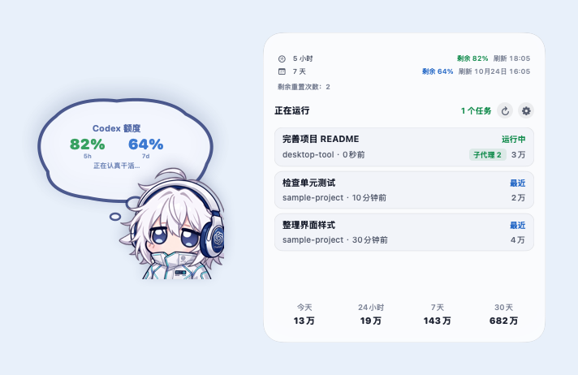
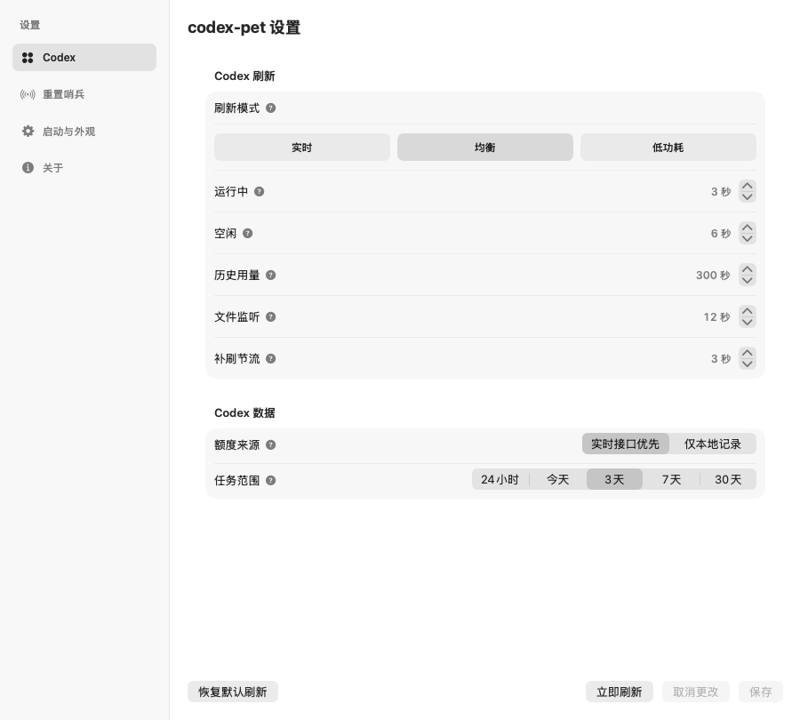
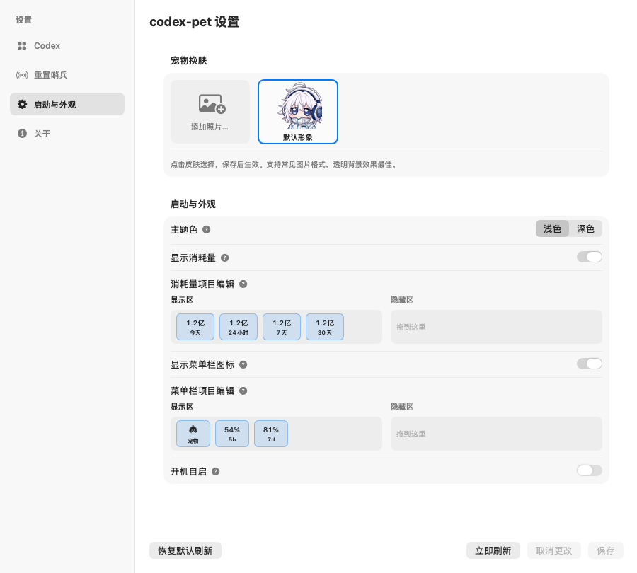
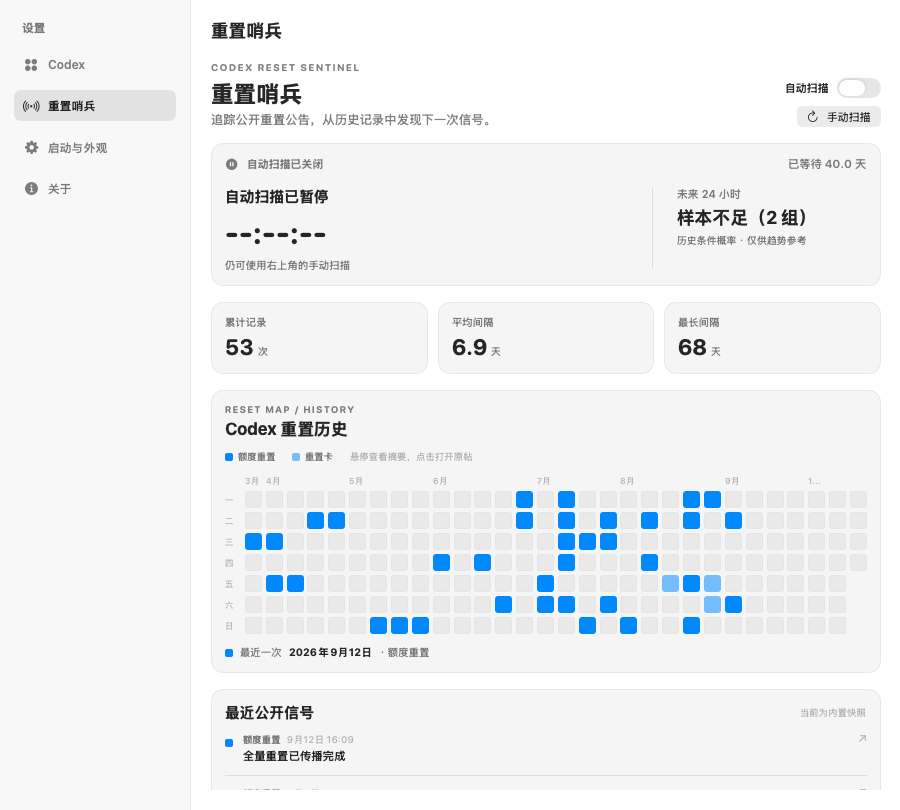

# codex-pet

让桌宠陪你写代码：在 macOS 桌面和菜单栏查看本机 Codex 的运行状态、剩余额度与 token 用量。

A native macOS desktop companion for Codex activity, remaining quotas, and local token usage.

[中文](#中文) · [English](#english) · [快速开始](#快速开始) · [使用流程](#使用流程) · [常见问题](#常见问题)



> 界面图使用项目现有 SwiftUI 视图渲染；任务名、额度和用量为示例数据，重置哨兵展示内置历史快照，不代表实时账号状态。为便于阅读，首图将桌宠和详情面板并排展示。

<a id="中文"></a>

## 中文

codex-pet 是一款原生 macOS 桌面宠物。宠物常驻桌面，通过气泡展示 Codex 剩余额度；点击宠物或菜单栏项目，可展开任务与用量详情。应用以菜单栏辅助应用运行，不显示 Dock 图标。

### 功能一览

| 功能 | 说明 |
| --- | --- |
| 桌面宠物 | 拖动调整位置，通过气泡查看剩余额度和运行状态 |
| 任务详情 | 查看运行中与最近活动的任务、任务 token 用量及活跃子代理数量 |
| 额度监测 | 显示可用的 `5h` / `7d` 额度窗口、刷新时间和剩余重置次数（数据源提供时） |
| 用量统计 | 查看今天、24 小时、7 天、30 天的本机 token 用量，支持排序和隐藏 |
| 菜单栏 | 显示宠物图标及 `5h` / `7d` 剩余额度，可调整顺序与显示项目 |
| 外观与启动 | 自定义宠物图片、浅色 / 深色主题、隐藏与恢复宠物、开机自启 |
| 重置哨兵 | 手动或自动扫描公开重置公告，查看历史分布、间隔统计与来源链接 |

### 快速开始

#### 环境要求

- macOS 14 或更高版本，支持 Apple Silicon 和 Intel Mac。
- 当前用户已有 Codex 本地会话数据，默认读取 `~/.codex`。
- 从源码运行需要 Swift 6 工具链及 Xcode Command Line Tools；可先执行 `swift --version` 检查。
- 默认额度查询使用本机 Codex 可执行文件及其现有登录状态，无需在 codex-pet 中额外填写账号或密钥。

#### 从源码构建（推荐本机使用）

在项目根目录执行：

```bash
# 克隆后进入项目；已有源码可跳过这两步
git clone https://github.com/Coldcrack/codex-pets.git
cd codex-pets

# 只生成适合当前 Mac 架构的 .app（默认先运行回归测试）
./scripts/build-app.sh --app-only

# 安装到 ~/Applications，并自动启动
./scripts/install-user-app.sh
```

安装脚本会关闭正在运行的 `CodexPets` 进程，并替换目标目录中已有的 `codex-pet.app`。如需自定义安装位置：

```bash
CODEX_PETS_INSTALL_DIR="/path/to/Applications" ./scripts/install-user-app.sh
```

仅调试运行，无需打包：

```bash
# 在项目根目录运行，便于读取 Resources 中的宠物图片
swift run CodexPets
```

#### 使用 DMG 安装

拿到构建生成的 DMG 后，选择与你的 Mac 匹配的文件：

| Mac 类型 | 文件名 |
| --- | --- |
| Apple Silicon（M 系列） | `codex-pets-<版本>-arm64.dmg` |
| Intel | `codex-pets-<版本>-amd64.dmg` |

打开 DMG，将 `codex-pet.app` 复制到 `Applications` 或 `~/Applications`，再启动应用。DMG 中的 App 与源码安装使用相同功能。

### 使用流程

#### 1. 启动并查看桌宠

启动后，宠物默认出现在主屏幕右下角，可以拖动到其他位置。

- 气泡中的百分比表示**剩余额度**，例如 `82%` 表示对应窗口还有 82% 可用。
- “正在认真干活…”表示检测到运行中的 Codex 任务；“摸鱼待命中…”表示当前待命。
- `--` 表示暂时没有对应额度数据，不代表额度耗尽。

#### 2. 点击查看任务与用量

点击宠物或左键点击菜单栏项目，打开详情面板（见上方界面图）。

- 顶部显示额度窗口、下一次刷新时间，以及数据源提供的剩余重置次数。
- 中间显示任务名称、状态、最近活动时间和 token 数；有活跃子代理时会显示数量标记。任务较多时可滚动查看。
- 底部显示各时间段的 token 总量；首次打开时可能需要等待历史统计完成。
- 点击刷新按钮可手动刷新，点击齿轮打开设置。点击面板外部或按 `Esc` 可收起详情。

| 指标 | 含义 |
| --- | --- |
| `5h` / `7d` | 数据源提供的额度窗口；百分比为剩余可用比例，缺少某个窗口时不一定同时显示两项 |
| 刷新时间 | 对应额度窗口预计重置的时间，按本机时间显示 |
| 剩余重置次数 | 账号数据源返回的可用重置次数；缺少数据时不显示，应用不提供额度重置操作 |
| 今天 | 从本机当天 00:00 到当前时刻的 token 用量 |
| 24 小时 / 7 天 / 30 天 | 对应滚动时间范围内的 token 用量 |
| 任务 token | 从本机任务与会话记录汇总的用量，不等同于金额或账单 |

统计仅覆盖当前 Mac 可读取的记录；历史记录缺失、刷新延迟和数据格式变化都可能影响结果，不能视为跨设备的账号总用量。

#### 3. 调整数据来源与刷新频率

右键宠物选择“设置”，或右键菜单栏项目选择“打开设置…”，进入 **Codex** 页签。



- 首次使用可保留默认“均衡”模式；任务较少时可切换“低功耗”。
- “实时接口优先”通过本机 `codex app-server --stdio` 查询额度，查询失败时回退到本地记录。
- “仅本地记录”从会话文件读取额度；记录可能滞后于账号实时状态。
- “任务范围”默认最近 3 天，可切换今天、24 小时、7 天或 30 天。该选项控制任务列表范围，与底部用量统计时间段分别配置。
- 修改后点击右下角 **保存**。“取消更改”放弃未保存项；“恢复默认刷新”只将刷新参数恢复为均衡预设，仍需保存。

刷新预设如下（单位：秒）：

| 模式 | 运行中 | 空闲 | 历史用量 | 文件监听 | 补刷节流 |
| --- | ---: | ---: | ---: | ---: | ---: |
| 实时 | 2 | 4 | 120 | 8 | 1 |
| 均衡（默认） | 3 | 6 | 300 | 12 | 3 |
| 低功耗 | 8 | 20 | 900 | 30 | 8 |

实际刷新还受缓存、文件变化和统计耗时影响。历史用量按需加载；详情面板收起后会暂停周期性历史统计。

#### 4. 换肤、调整菜单栏与开机自启

进入 **启动与外观** 页签：



1. 点击“添加照片…”导入图片，选择皮肤后点击 **保存**。支持常见图片格式，透明背景效果更好；选择“默认形象”可恢复内置形象。
2. 选择浅色或深色主题，调整详情面板与气泡外观。
3. 在“消耗量项目编辑”中拖动项目调整顺序，或拖入隐藏区域；需至少保留一项。
4. 在“菜单栏项目编辑”中调整宠物、`5h` 和 `7d` 项目的顺序与显示状态。
5. 按需开启“开机自启”，点击 **保存**；建议在安装好的 `.app` 中设置。

右键宠物选择“隐藏宠物”后，菜单栏入口会保持开启。恢复时右键菜单栏项目，选择“显示宠物”。退出应用可在宠物右键菜单或菜单栏右键菜单中选择“退出 codex-pet”。

#### 5. 查看重置公告（可选）

进入 **重置哨兵** 页签：



- 点击“手动扫描”获取公开重置公告；“自动扫描”默认关闭。
- 开启自动扫描后，会立即扫描，并在该视图保持活动时于整点和半点继续刷新；关闭该页签后不应当作后台监控服务使用。
- 页面提供重置历史分布、平均 / 最长间隔、最近公告及原文入口。
- 未获取到实时数据时可查看内置历史快照；扫描失败会提示雷达暂不可用，记录可能不是最新。
- 概率和间隔来自历史样本，只是参考，不保证下一次重置时间，也不会替账号执行重置。

### 数据来源与联网行为

**任务和 token 统计以本机记录为依据；额度查询和公开公告扫描可能联网。**

| 数据 / 设置 | 来源与行为 |
| --- | --- |
| 任务与运行状态 | `~/.codex/state_*.sqlite`、`logs_*.sqlite`、`sessions` 及 rollout JSONL；SQLite 文件自动选择数字版本最高的文件，缺省名称为 `state_5.sqlite` / `logs_2.sqlite` |
| 任务名称 | 本机会话元数据与 `~/.codex/session_index.jsonl` |
| 额度（默认） | 调用本机 Codex app-server 的 `account/rateLimits/read`；Codex 可能使用已有登录状态请求服务，失败回退到本地记录 |
| 额度（仅本地记录） | 使用本机会话中记录的额度快照，不调用实时额度接口 |
| 重置哨兵 | 手动扫描或开启自动扫描时访问 `https://codex-resets.com/api/resets`；点击公告原文会打开对应 X 链接 |
| 偏好与皮肤 | 偏好保存于本机 UserDefaults；导入的皮肤存放于 `~/Library/Application Support/codex-pets/PetSkins` |

应用不要求配置远程管理面板地址、账号、密码或管理密钥。读取 Codex 会话和数据库的逻辑不修改这些数据文件；应用会保存自己的偏好和导入图片。

需要仅查看本地记录时，将“额度来源”设为“仅本地记录”，并保持重置哨兵自动扫描关闭、不要触发手动扫描。当前默认数据目录固定为 `~/.codex`，没有提供自定义目录或 `CODEX_HOME` 设置。

### 常见问题

| 问题 | 排查方式 |
| --- | --- |
| 启动后没有 Dock 图标 | 正常行为。通过桌宠或菜单栏操作应用 |
| 找不到桌宠 | 右键菜单栏项目 →“显示宠物”；首次启动默认位于主屏幕右下角 |
| 额度为 `--` 或只有一个窗口 | 先在 Codex 中正常登录并产生一次活动，再尝试刷新；检查“额度来源”。缺失窗口不会凭空补齐 |
| 实时额度没有更新 | 确认 Codex 可执行文件可用；默认依次查找 `/Applications/Codex.app/Contents/Resources/codex`、`/Applications/ChatGPT.app/Contents/Resources/codex` 和进程 `PATH` 中的 `codex`，GUI 启动时的 `PATH` 可能与终端不同 |
| 没有任务 / token 统计不完整 | 确认当前用户的 `~/.codex` 中有会话记录，扩大“任务范围”，展开详情后等待统计或手动刷新；其他 Mac 的使用量不在本机统计内 |
| 改了设置没有生效 | 除重置哨兵的扫描开关外，常规设置修改后需要点击“保存”；皮肤选择也需要保存 |
| 开机自启失败 | 先将 `.app` 安装到稳定目录后再启用，并检查设置页错误提示及 macOS 登录项设置 |
| 哨兵显示内置快照 | 尚未成功扫描或公开接口不可用；点击“手动扫描”重试。快照不影响本机任务监测 |
| 安装脚本提示 Missing app | 先执行 `./scripts/build-app.sh --app-only`，确认存在 `dist/codex-pet.app` |

### 开发、打包与诊断

#### 构建产物

```bash
# 只构建当前架构的 release 可执行文件
swift build -c release

# 当前架构 .app
./scripts/build-app.sh --app-only

# 分别构建 arm64 / x86_64，生成两个 DMG 和当前架构 .app
./scripts/build-app.sh
```

产物位于 `dist/`：

```text
dist/
├── codex-pet.app
├── codex-pets-0.0.1-arm64.dmg
└── codex-pets-0.0.1-amd64.dmg
```

版本号以 `scripts/build-app.sh` 为准。完整打包会清理同目录旧的匹配 DMG。打包脚本默认运行完整回归测试；已经验证且只想重新打包时，可显式使用 `CODEX_PETS_SKIP_TESTS=1 ./scripts/build-app.sh --app-only`。

当前脚本使用 ad-hoc 签名；面向公众分发的版本应另行配置 Developer ID 签名与 notarization。

#### 诊断快照

在 `swift build -c release` 后执行（命令输出快照后即退出，不启动桌宠）：

```bash
# 完整快照，包含历史 token 统计
.build/release/CodexPets --print-snapshot
.build/release/CodexPets --print-snapshot-json

# 快速快照，跳过历史用量扫描
.build/release/CodexPets --print-fast-snapshot
.build/release/CodexPets --print-fast-snapshot-json
```

JSON 包含 `quota_windows`、`reset_credits`、`running`、`usage_today` / `usage_24h` / `usage_7d` / `usage_30d`、`tasks` 和 `error` 等字段。快速快照中的用量数值不能用于判断历史消耗是否为零；快照命令默认仍使用实时接口优先的额度来源。

分享诊断输出前请检查任务标题等个人信息。快照最多输出 4 个任务，不能当作完整任务导出。

#### 测试

```bash
# Swift 单元测试
swift test

# release 单元测试 + 独立本机数据回归测试
./scripts/run-regression-tests.sh
```

#### 项目结构与命名

```text
Package.swift                         Swift Package 配置（macOS 14+ / Swift 6）
Sources/CodexPets/
├── AppDelegate.swift                 应用入口、桌宠窗口、菜单栏与设置窗口
├── PetDashboardView.swift            桌宠气泡与任务详情视图
├── UsageViewModel.swift              数据刷新、文件监听和界面状态
├── CodexUsageStore.swift             本机数据读取、token 统计与额度查询
├── CodexPetsSettings.swift           本机偏好、皮肤与开机自启
├── SettingsView.swift                刷新、数据、外观与启动设置
├── ResetSentinel.swift               公开重置公告读取与历史统计
├── ResetSentinelView.swift           重置哨兵界面
├── DetailPanelMetrics.swift          桌宠与详情面板尺寸
└── ScreenSafeAreaGeometry.swift      屏幕安全区计算
Tests/CodexPetsTests/                  Swift 单元测试
Tests/CodexPetsRegressionTests/        本机数据回归测试
Resources/                            默认宠物图片、App 与菜单栏图标
docs/images/                          README 界面图
scripts/build-app.sh                  构建 .app / DMG
scripts/install-user-app.sh           安装并启动 .app
scripts/run-regression-tests.sh       运行完整回归测试
```

App 显示名和安装名是 `codex-pet`；Swift Package、模块及可执行文件名是 `CodexPets`；仓库目录和 DMG 前缀是 `codex-pets`。本机监测依赖 Codex 的本地数据格式，格式变化后可能需要同步适配。

<a id="english"></a>

## English

Codex Pet is a native macOS desktop companion. Its pet shows remaining Codex quotas in a speech bubble; click the pet or menu-bar item to open task and usage details. It runs as an accessory app without a Dock icon.

The images above are rendered from the project's SwiftUI views with sample task names, quotas, and usage. Reset Sentinel shows its bundled historical snapshot. The overview places the pet and detail panel side by side for readability.

### Features

- Draggable desktop pet with remaining quotas and running / idle status.
- Running and recent tasks, per-task token usage, and active subagent counts.
- Available `5h` / `7d` quota windows, reset times, and reset credits when supplied by the data source.
- Local token totals for today and rolling 24-hour, 7-day, and 30-day periods.
- Reorderable, hideable usage and menu-bar items.
- Custom pet images, light / dark themes, hide / restore, and launch at login.
- Optional Reset Sentinel for public reset announcements and historical statistics.

### Quick Start

Requires macOS 14+ on Apple Silicon or Intel. Source builds require a Swift 6 toolchain and Xcode Command Line Tools. Codex must have local session data under the current user's `~/.codex`; live quota lookup uses the locally installed Codex executable and its existing account state.

```bash
git clone https://github.com/Coldcrack/codex-pets.git
cd codex-pets

# Build a .app for this Mac; runs regression tests first
./scripts/build-app.sh --app-only

# Install to ~/Applications and launch
./scripts/install-user-app.sh
```

The installer stops running `CodexPets` processes and replaces the existing target app. Override the destination with `CODEX_PETS_INSTALL_DIR="/path/to/Applications" ./scripts/install-user-app.sh`.

For development, run `swift run CodexPets` from the repository root so artwork can be found in `Resources`.

For DMG installation, use `codex-pets-<version>-arm64.dmg` for Apple Silicon or `codex-pets-<version>-amd64.dmg` for Intel. Copy `codex-pet.app` to `Applications` or `~/Applications`, then launch it.

### Usage Walkthrough

1. **Launch and position the pet.** It appears near the main screen's bottom-right corner. Drag it to reposition. Percentages show **remaining** quota; `--` means unavailable data.
2. **Open details.** Click the pet or left-click the menu-bar item. View quota reset times, tasks, active subagents, and period usage. Use the refresh button to reload or the gear to open settings. Click outside or press `Esc` to dismiss.
3. **Configure data.** Right-click the pet → “设置”, or right-click the menu-bar item → “打开设置…”. In the **Codex** tab, choose a refresh preset, quota source, and task range, then click **保存** (Save). The default task range is 3 days; changing it does not change the period-usage windows.
4. **Customize appearance.** In **启动与外观** (Launch & Appearance), import an image using “添加照片…”, select it, and save. Transparent images work best. Drag usage or menu-bar items to reorder or hide them. At least one usage item must remain visible. Theme and launch-at-login changes also require Save.
5. **Hide or restore.** Right-click the pet → “隐藏宠物”. The menu-bar entry stays available; right-click it → “显示宠物” to restore. Both context menus provide “退出 codex-pet” to quit.
6. **Explore Reset Sentinel.** In **重置哨兵**, click “手动扫描” to fetch public announcements. Automatic scanning is off by default. When enabled, it scans immediately and at each hour / half-hour while the view remains active. It is not a background monitoring service. Statistics and historical estimates do not guarantee a future reset or perform account resets.

See the illustrated Chinese walkthrough above for the [Codex settings](docs/images/settings-codex.png), [appearance settings](docs/images/settings-appearance.png), and [Reset Sentinel](docs/images/reset-sentinel.png).

### Metrics and Refresh

“Today” starts at local midnight; 24 hours / 7 days / 30 days are rolling periods. Task tokens and period totals come from locally available records. They are not monetary balances or a cross-device account total. Reset credits appear only when supplied by the account data source.

| Preset | Active | Idle | Usage history | File watcher | Change throttle |
| --- | ---: | ---: | ---: | ---: | ---: |
| Realtime | 2 s | 4 s | 120 s | 8 s | 1 s |
| Balanced (default) | 3 s | 6 s | 300 s | 12 s | 3 s |
| Economy | 8 s | 20 s | 900 s | 30 s | 8 s |

Caching, file changes, and scan duration also affect updates. Period usage loads on demand, and its periodic refresh pauses when details close. “恢复默认刷新” restores the balanced refresh values in the settings draft; click Save to apply.

### Data and Network Access

Task and token statistics use local data. Live quota lookup and public announcement scans may access the network.

- **Local records:** `~/.codex/state_*.sqlite`, `logs_*.sqlite`, `session_index.jsonl`, session metadata, and rollout JSONL files. The highest numbered SQLite version is selected, with `state_5.sqlite` / `logs_2.sqlite` as fallback names. The app's reader does not modify these records.
- **Live quotas (default):** calls `account/rateLimits/read` through local `codex app-server --stdio`, which may contact services using the existing Codex account state. Falls back to local quota records on failure.
- **Local-only quotas:** “仅本地记录” uses recorded session snapshots, which may be stale.
- **Reset Sentinel:** manual / automatic scans access `https://codex-resets.com/api/resets`. Announcement links open X. A bundled historical snapshot remains available before a successful scan; a failed scan may leave older data visible.
- **App settings:** preferences use local UserDefaults; imported artwork is stored in `~/Library/Application Support/codex-pets/PetSkins`.

No remote management URL, account, password, or management key needs to be entered in this app. To use local records only, select “仅本地记录”, leave automatic Sentinel scanning off, and do not trigger manual scans. The data directory currently defaults to a fixed `~/.codex`; there is no custom-directory or `CODEX_HOME` setting.

### Troubleshooting

| Symptom | What to check |
| --- | --- |
| No Dock icon / missing pet | No Dock icon is expected. Right-click the menu-bar item → “显示宠物” |
| Quota is `--` or a window is missing | Sign in and use Codex, refresh, and check the selected quota source. Missing windows are not invented |
| Live quota lookup fails | The app searches the Codex executable in `/Applications/Codex.app/Contents/Resources/codex`, then `/Applications/ChatGPT.app/Contents/Resources/codex`, then the process `PATH`. GUI and terminal environments may differ |
| Tasks or usage are incomplete | Check local session records and the task range; open details and wait for history to load, or refresh. Other devices are outside this app's scope |
| Settings / skin changes do not apply | Click **保存** (Save). The Sentinel scan toggle applies directly |
| Launch at login fails | Enable it from an installed `.app` in a stable location; check the settings error and macOS login items |
| Sentinel shows a snapshot | Retry a manual scan. Public feed availability does not affect local task monitoring |
| Installer reports a missing app | Run `./scripts/build-app.sh --app-only` first |

### Build, Diagnostics, and Tests

```bash
# Release executable
swift build -c release

# Current-architecture .app
./scripts/build-app.sh --app-only

# Both architecture-specific DMGs and a current-architecture .app
./scripts/build-app.sh

# Full snapshots, including period usage; print and exit
.build/release/CodexPets --print-snapshot
.build/release/CodexPets --print-snapshot-json

# Fast snapshots, skipping historical usage scans
.build/release/CodexPets --print-fast-snapshot
.build/release/CodexPets --print-fast-snapshot-json

# Unit tests
swift test

# Release unit tests and standalone local-data regressions
./scripts/run-regression-tests.sh
```

Artifacts are written to `dist/`: `codex-pet.app`, `codex-pets-<version>-arm64.dmg`, and `codex-pets-<version>-amd64.dmg`. The version is defined in `scripts/build-app.sh`. Full packaging removes matching older DMGs. Builds run regression tests by default; after validation, use `CODEX_PETS_SKIP_TESTS=1` explicitly if repackaging without tests.

Fast snapshot usage values do not indicate historical usage is zero. Snapshot commands default to live-first quota lookup, include at most four tasks, and may expose task titles; review them before sharing. JSON includes quota windows, reset credits, running state, period usage, tasks, timestamps, and errors.

The build script uses ad-hoc signing. Public distribution requires separately configured Developer ID signing and notarization. Local monitoring depends on Codex's local data formats and may require updates when they change.

App / bundle / installation name: `codex-pet`. Swift package, module, and executable: `CodexPets`. Repository directory and DMG prefix: `codex-pets`. Source lives in `Sources/CodexPets`, tests in `Tests`, artwork in `Resources`, documentation images in `docs/images`, and build / install / regression scripts in `scripts`.
